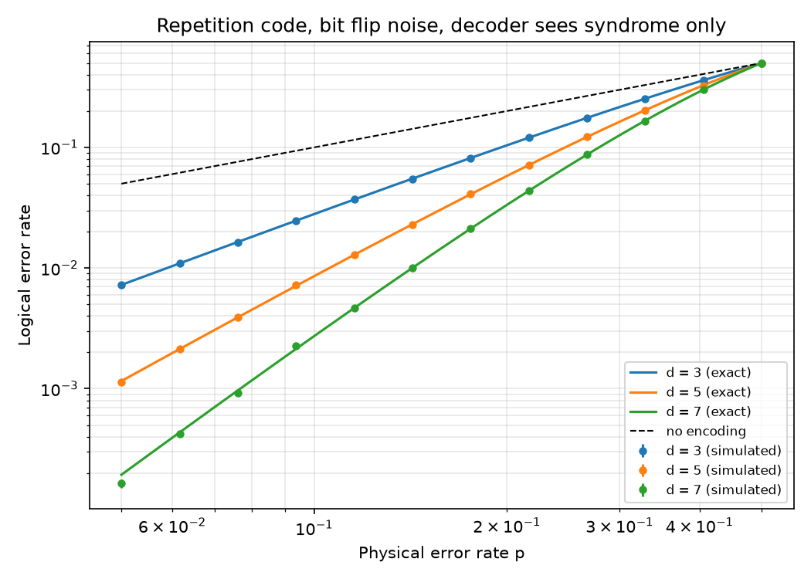
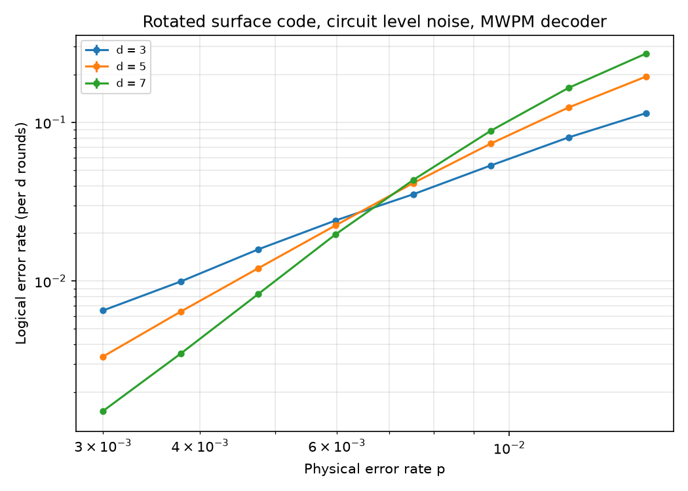
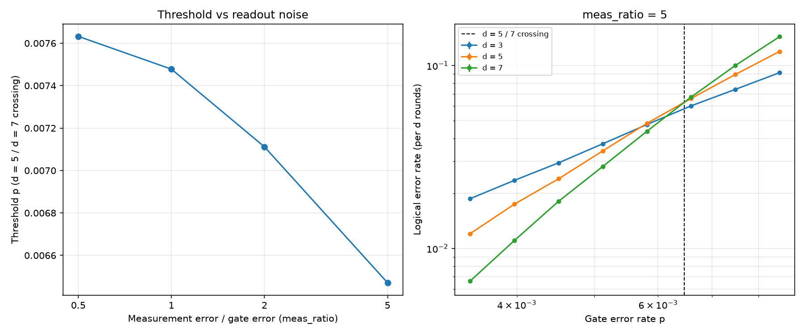

# qec-decoding

Simulations of the repetition code and the rotated surface code, with threshold
estimates from Monte Carlo sampling. The surface code study uses Stim and
PyMatching, and also measures how the threshold changes when measurement error
is larger than gate error.

## Motivation

Quantum error correction caught my attention because of one question: if quantum information is so fragile, how can it be protected and recovered without directly observing the errors?

The decoder is where that question gets answered. It has to work out what most likely went wrong using only syndrome measurements, even though those measurements can themselves be unreliable. I wanted to understand how decoders make that call, how their performance changes as noise increases and what limits them. This repo is the first stage. It covers the repetition code and surface code thresholds, with a decoder of my own coming next.

## What's here

- `src/`: the repetition code with its syndrome decoder and exact formula (`repetition.py`), and surface code circuit construction, sampling and threshold estimation (`surface.py`).
- `scripts/`: one script per study, each writing a figure to `figures/` and, for the surface code, a CSV to `results/`.
- `tests/`: pytest checks for both codes, including zero logical errors at p = 0 and a smaller logical error rate at larger distance below threshold.

## Results

### (a) Repetition code

One logical bit is stored in d physical bits, each flipping independently with
probability p. The decoder sees only the syndrome (the parities of neighbouring
bits), not the bits themselves. The syndrome determines the error up to a
global flip, so there are two candidate errors, and the decoder picks the one
with fewer flips. Decoding fails exactly when more than half the bits flip, so
the logical error rate is

P_L = Σ_{k > d/2} C(d, k) p^k (1 − p)^(d − k).

The simulation used d = 3, 5, 7 and 12 values of p from 0.05 to 0.5, with
1,000,000 shots per point. It matches this formula within shot noise. All 36
points lie within 2.5σ of the exact value, and χ² = 40.4 over 36 points.



### (b) Surface code threshold

Setup:

- Stim's `surface_code:rotated_memory_z` experiment with rounds = d, for d = 3, 5, 7.
- Uniform circuit level noise at p:
  - depolarising noise after every Clifford gate and on every data qubit at the start of each round
  - bit flips after reset and before measurement
- A minimum weight perfect matching decoder from PyMatching, built from the detector error model that Stim derives from the circuit.

Logical error rates are per d rounds. Each is the probability that the whole
d round memory experiment ends with the wrong logical outcome.

**Threshold estimate: about 0.75%.** This is the d = 5 / d = 7 crossing at
meas_ratio = 1 from the measurement study in (c), which samples p more finely
near the crossing.

Shot noise on this estimate is about 0.01 percentage points. That figure comes
from a parametric bootstrap that resamples each point binomially and repeats
the interpolation. The choice of p grid matters more. The first sweep shown
below used a coarser grid and gave about 0.7% (0.709% for the d = 5 / d = 7
crossing), about 0.04 percentage points lower. So only two significant figures
are reliable. The crossings between other pairs in the first sweep were 0.641%
(d = 3 / d = 5) and 0.669% (d = 3 / d = 7).

Below threshold, larger distance helps. At p = 0.3%, the logical error rate is
0.653% for d = 3, 0.335% for d = 5 and 0.152% for d = 7.



The first sweep used 8 values of p from 0.003 to 0.015, with 500,000 shots per
point. The 1σ binomial error bars are smaller than the markers.

### (c) Measurement error study

Readout is often noisier than gates on current superconducting devices. To
model this, the measurement flip probability is set to meas_ratio × p, and all
other noise stays at p. This applies to the check qubit measurement in every
round and to the final data qubit readout.

The threshold is taken as the point where the d = 5 and d = 7 curves cross.
It is found by interpolating log(logical rate) against log(p) between the two
sampled points either side of the crossing. Each ratio uses 8 values of p,
chosen to bracket its crossing, with 300,000 shots per point.

| meas_ratio | Threshold p | p range sampled |
|---|---|---|
| 0.5 | 0.76% | 0.50% to 1.10% |
| 1 | 0.75% | 0.50% to 1.00% |
| 2 | 0.71% | 0.45% to 0.90% |
| 5 | 0.65% | 0.35% to 0.85% |



Raising meas_ratio from 1 to 5 lowers the threshold from 0.75% to 0.65%, a
fall of about 13%. This fall is larger than both shot noise and the grid
effect described in (b), but the steps between neighbouring ratios are less
certain. The drop is small because measurement is only one of several noise
locations in each round. A weight four check qubit undergoes four
two qubit gates, each followed by two qubit depolarising noise at p, as well
as a reset with its own flip. Every data qubit is also depolarised once per
round. Measurement adds one flip per check qubit per round, so increasing it
fivefold raises the total noise per round by much less than a fivefold
increase in gate error would.

The 0.5 and 1 results differ by less than 0.02 percentage points, which is about 1σ of shot noise, so they are within noise of each other.

## Running it

Tested with Python 3.11.

```sh
python3 -m venv .venv
source .venv/bin/activate
pip install -r requirements.txt

pytest

python scripts/plot_repetition.py     # figures/repetition_threshold.png
python scripts/surface_threshold.py   # results/surface_threshold.csv, figures/surface_threshold.png
python scripts/measurement_study.py   # results/measurement_study.csv, figures/measurement_study.png
python scripts/readme_numbers.py      # numbers quoted above, read from results/
```

`readme_numbers.py` reads the two CSVs, so run it after the surface code
scripts. It prints:

- the first sweep's logical error rates
- the crossing for each pair of distances, with its bootstrap shot noise
- the d = 5 / d = 7 crossing and its shot noise for each meas_ratio
- the difference between the meas_ratio = 1 and 0.5 thresholds

On a MacBook, the surface threshold script takes about 1.5 minutes and the
measurement study about 3.5 minutes. Fixed seeds reproduce the numbers above
exactly with the pinned versions in `requirements.txt` on the same machine.
Elsewhere, results should agree within shot noise.

## Limitations

- Simulation only. Nothing here has been run on hardware.
- The noise model is uniform: a single p for all gates, resets and idling. The only variation is the readout ratio in (c).
- The surface code decoder is PyMatching, a library decoder, not one written for this project.
- The distances are small (d ≤ 7), and crossings between small codes move with distance, so the thresholds are finite size estimates.
- Logical error rates are per d rounds, not per round, so they are not directly comparable with per round figures.

## Next steps

Planned: a union find decoder written for this project, benchmarked against
PyMatching on the same circuits for accuracy (logical error rates and
threshold) and speed (decoding time per shot).
